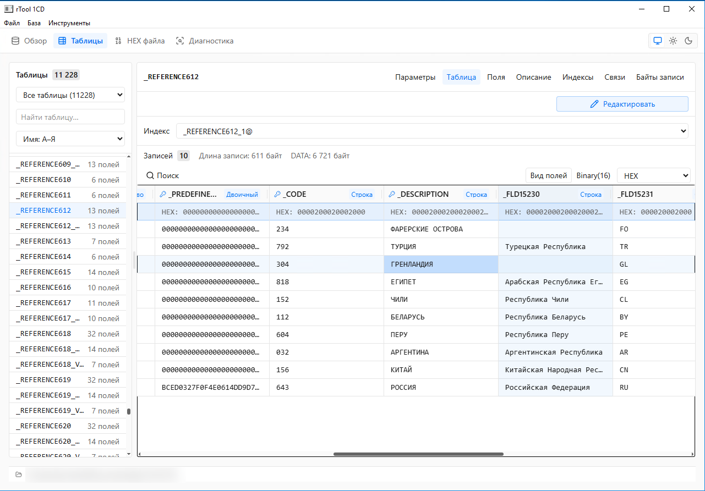
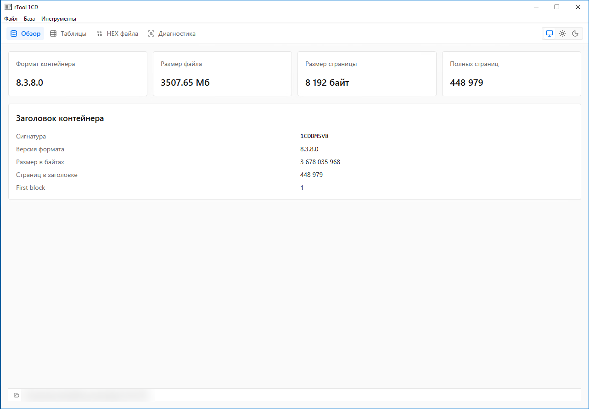
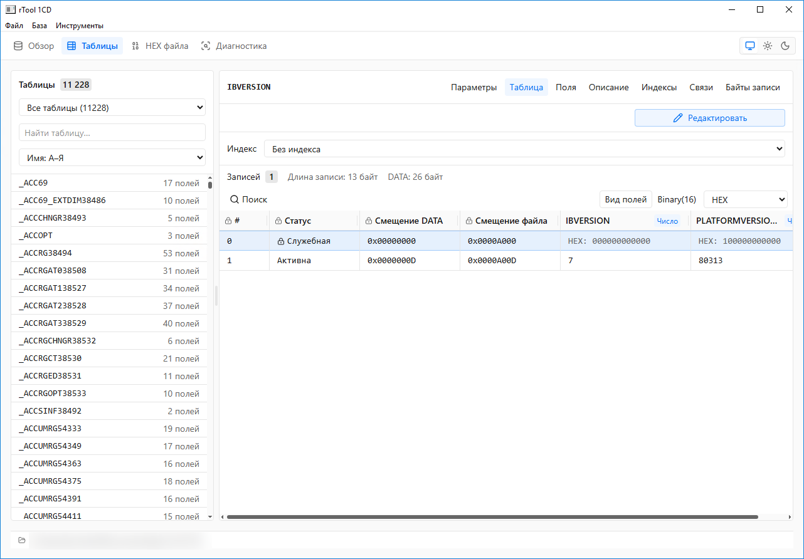
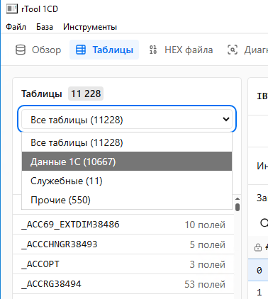
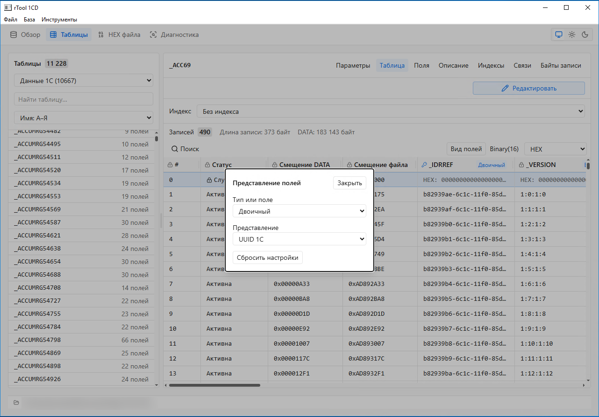
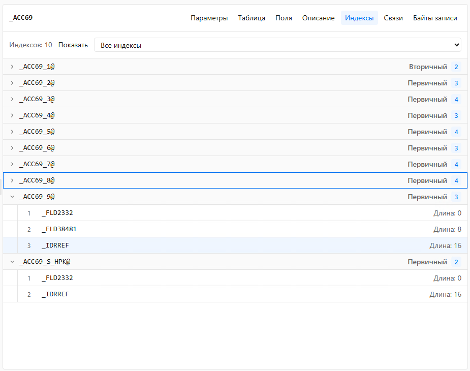
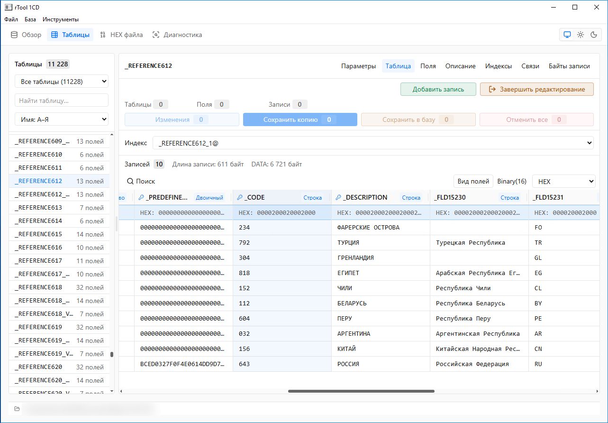
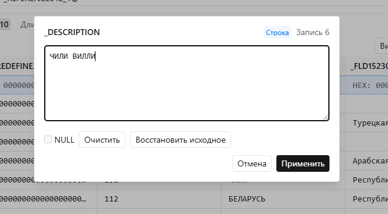

<h1 align="center">rTool 1CD</h1>

Просмотр и редактирование файловых баз 1С

  
  

  
  
  
  
  

  <a href="https://github.com/godzzdeal/rtool-1cd/releases/download/1.1.0-beta/rTool.1CD_1.1.0-beta_x64-setup.exe"><strong>Скачать установщик</strong></a>
  &nbsp; | &nbsp;
  <a href="RELEASE-NOTES.md">Описание выпуска</a>
  &nbsp; | &nbsp;
  <a href="https://github.com/godzzdeal/rtool-1cd/issues">Сообщить об ошибке</a>

---

## Возможности

- Таблицы, поля, записи и индексы.
- Поиск по данным и настройка представления полей.
- Схема связей таблиц и просмотр в HEX.
- Изменение значений, добавление и удаление записей в поддерживаемых таблицах.
- Сохранение всех правок в копию или открытую базу.

Бета-версия предназначена для файлов .1CD формата **8.3.8.0**.

## Скриншоты

Обзор базы

Каталог таблиц и отбор

Представление полей и индексы

Редактирование записей

## Установка

Скачайте установщик для Windows x64 и запустите его. Приложение устанавливается для текущего пользователя.

Недостающие компоненты установщик предложит установить сам. Если потребуется ручная установка, используйте официальные страницы Microsoft:

- [Visual C++ 2010 SP1 x64](https://www.microsoft.com/en-us/download/details.aspx?id=26999) — выберите **vcredist_x64.exe**.
- [WebView2 Runtime](https://developer.microsoft.com/en-us/microsoft-edge/webview2/#download-section) — выберите **Evergreen Standalone Installer, x64**.

Установщик не подписан. [Скачать SHA-256](https://github.com/godzzdeal/rtool-1cd/releases/download/1.1.0-beta/rTool.1CD_1.1.0-beta_x64-setup.exe.sha256).

> [!IMPORTANT]
> Перед редактированием закройте базу в 1С и сделайте резервную копию. Редактируйте тестовую копию базы.

## Благодарности

Благодарю [Валерия Агеева](https://bitbucket.org/awa15/), автора [Tool_1CD](https://bitbucket.org/awa15/tool_1cd-sources), за создание инструмента и публикацию исходного кода. Его работа вдохновила меня разработать rTool 1CD на Rust.

## Обратная связь

[Создайте Issue](https://github.com/godzzdeal/rtool-1cd/issues) с версией приложения, форматом базы и шагами, которые привели к ошибке. Не прикладывайте рабочие базы и конфиденциальные данные.
